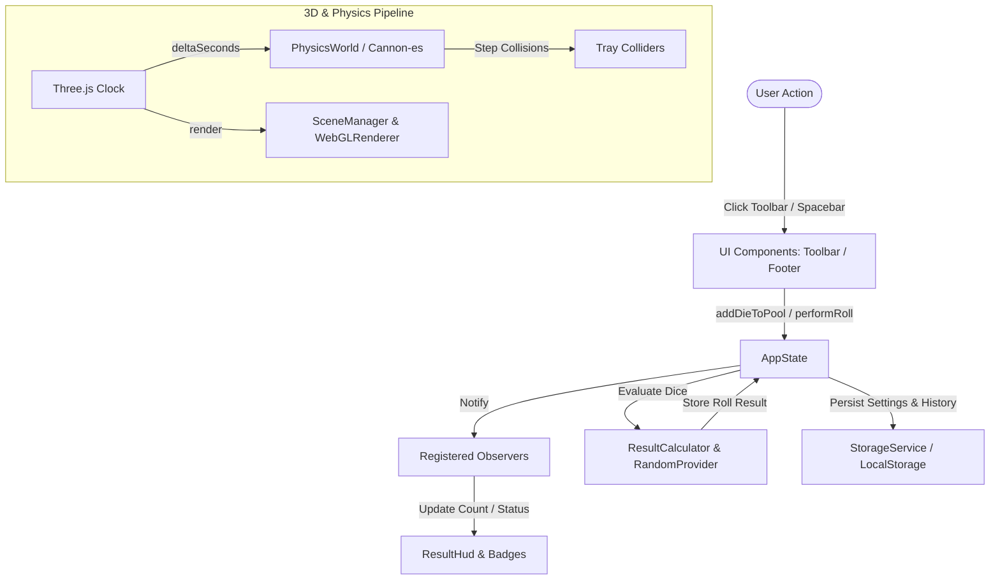

# Architecture Documentation

## 1. High-Level Architectural Principles

The application is structured as a high-performance, portable desktop application dividing responsibilities strictly between:

1. **Native Shell (Rust / Tauri 2.x):**
   - Native OS window lifecycle, sizing, title bars, and display scaling.
   - Low-footprint, sandboxed webview environment using Windows WebView2.
   - Future file system access and offline packaging capabilities.
   - Rust does *not* participate in game simulation, rendering, or physics calculations, avoiding inter-process serialization overhead during active 60+ FPS animation loops.

2. **Core Simulation & Engine Layer (TypeScript / Three.js / Cannon-es):**
   - **Three.js:** Handles WebGL scene graph, perspective camera math, soft shadow mapping, and PBR (Physically-Based Rendering) materials.
   - **Cannon-es:** Simulates rigid body dynamics, gravity, collisions against tray boundaries, restitution, and friction.
   - **CryptoRandomProvider:** Ensures fair, cryptographically strong rolls with rejection sampling to eliminate modulo bias.

3. **State Management & UI Layer (Reactive Observable Pattern):**
   - `AppState` acts as the single source of truth for dice pool composition, current roll lifecycle status, latest results, history, and preferences.
   - Decoupled observer subscriptions ensure components (`DiceToolbar`, `ResultHud`, `FooterControls`) react cleanly without unnecessary DOM thrashing or reliance on heavy frontend frameworks.
   - `StorageService` provides a clean persistence abstraction over browser `localStorage` with in-memory fallbacks for non-browser runtimes.

---

## 2. Component Boundaries & Directory Structure

```
src/
├── app/
│   ├── App.ts                # Application coordinator, DOM tree builder, error boundary
│   └── bootstrap.ts          # Bootstrap entry, window unload listeners
├── audio/
│   └── AudioManager.ts       # Audio lifecycle and procedural synthesis contract
├── config/
│   ├── defaultSettings.ts    # Application defaults (theme, audio, physics, rendering)
│   ├── diceConfig.ts         # Polyhedral metadata (sides, labels, default colors)
│   └── physicsConfig.ts      # Tray dimensions and physics constants
├── core/
│   ├── dice/DiceFactory.ts   # Dice instantiation and unique instance ID generation
│   ├── physics/PhysicsWorld.ts # Cannon-es integration and static boundary colliders
│   ├── random/RandomProvider.ts # Fair crypto RNG
│   ├── results/ResultCalculator.ts # Aggregate score and critical hit/miss evaluator
│   └── state/
│       ├── AppState.ts       # Reactive observable store
│       └── persistence.ts    # StorageProvider abstraction and LocalStorageProvider
├── rendering/
│   ├── camera/CameraRig.ts   # Tabletop perspective camera
│   ├── geometries/TrayMesh.ts # 3D dice tray geometry (felt floor, walls, gold trim)
│   ├── lighting/LightingRig.ts # Key directional light, soft shadows, and fill light
│   ├── materials/MaterialFactory.ts # Material cache and disposal tracker
│   └── scene/SceneManager.ts # Master Three.js scene manager and animation loop
├── styles/
│   ├── tokens.css            # Dark theme CSS design tokens
│   └── main.css              # Reset, glassmorphism panels, and global styles
├── types/                    # Strict TypeScript definitions
├── ui/
│   ├── components/           # DiceToolbar, ResultHud, FooterControls, HistoryDrawer
│   ├── icons/                # Polyhedral dice symbols and icons
│   ├── menus/MenuBar.ts      # Top desktop menu bar
│   └── settings/SettingsModal.ts # Settings dialog placeholder
└── utils/math.ts             # Clamping, angle conversion, and range helpers
```

---

## 3. Data Flow



---

## 4. 3D Dice Geometry & Rendering Architecture (Phase 2)

### 4.1 Exact Mathematical Polyhedra (`PolyhedronData.ts`)
Each die is constructed from analytical geometry with normalized outward-facing counter-clockwise (CCW) face winding:
- **D4 (Tetrahedron):** 4 equilateral triangular faces formed by alternating vertices of a cube.
- **D6 (Hexahedron):** 6 square faces.
- **D8 (Octahedron):** 8 equilateral triangular faces on coordinate axes.
- **D10 (Pentagonal Trapezohedron):** Genuine 10-faced dual of a pentagonal antiprism with congruent deltoid (kite) faces. Planarity is maintained mathematically using the precise height ratio $H/h = 5 + 2\sqrt{5} \approx 9.472136$, ensuring coplanar kite quadrilaterals with zero non-planar warping (tetrahedron volume $< 10^{-4}$).
- **D12 (Dodecahedron):** 12 regular pentagonal faces derived from golden ratio coordinates $(\pm 1, \pm 1, \pm 1)$, $(0, \pm \phi, \pm 1/\phi)$, $(\pm 1/\phi, 0, \pm \phi)$, and $(\pm \phi, \pm 1/\phi, 0)$.
- **D20 (Icosahedron):** 20 equilateral triangular faces derived from 3 orthogonal golden rectangles.

### 4.2 Comprehensive Metadata & Collision Preparation
Every die exposes `DieGeometryMetadata` containing:
- Logical face identifiers, face numeric values, local-space outward face normals, centroids, vertex positions, local bounding radius, and physics hull vertices/faces ready for Cannon-es `ConvexPolyhedron` instantiation in Phase 3.
- `DieMesh.getUpwardFace(worldUp)` evaluates $\max_i (\mathbf{R} \cdot \mathbf{n}_i \cdot \mathbf{u}_{\text{world}})$ using the die's world rotation matrix $\mathbf{R}$, enabling instant and mathematically robust face-up detection.

### 4.3 Dual Geometry Styles (`DiceGeometryBuilder.ts`)
- **Sharp Edge Style:** Flat, crisp facets targeting artisan resin dice.
- **Rounded / Soft Edge Style:** Real geometric edge quads and corner fans computed by insetting face vertices by 14% toward each face centroid. Edge quads bridge adjacent face boundaries and corner fans cap vertices, providing smooth tumbling contours without relying on lighting normal tricks.

### 4.4 Procedural Texture Atlas Pipeline (`DiceTextureGenerator.ts`)
- Procedural HTML5 Canvas atlas generation creates crisp, high-resolution textures without external image file overhead.
- Generates themed backdrops (polished marble resin, obsidian gold flecks, translucent amethyst gem, cyber neon grid lines, crimson dragon scales, walnut wood grain).
- Renders numerals with recessed drop shadows, crisp contrast, and bottom underline dots on ambiguous '6' and '9' numerals.
- Texture mapping projects face vertices onto atlas cells using face tangent and bitangent local coordinate frames, guaranteeing distortion-free rendering across triangles, kites, squares, and pentagons.

### 4.5 PBR Materials & Theming (`DiceMaterialManager.ts`, `themeConfig.ts`)
- Pre-configured PBR presets: `classic-ivory`, `obsidian-gold`, `royal-purple-gem`, `cyber-neon`, `crimson-dragon`, and `walnut-wood`.
- Supports custom user body and numeral color overrides.
- Implements an LRU-style cache key system to prevent duplicate texture or material allocations.

---

## 5. Resource Lifecycle & Disposal

To ensure zero memory leaks and crash resistance in long-running desktop sessions:
- Geometries, materials, and textures created by `MaterialFactory`, `DiceMaterialManager`, `TrayMesh`, and `SceneManager` are explicitly tracked and freed via `dispose()`.
- The WebGL rendering loop cleanly cancels `requestAnimationFrame`.
- Window resize listeners use a `ResizeObserver` disconnected upon application unmount.
- Web Audio contexts in `AudioManager` are cleanly closed upon disposal.
